# Hướng dẫn sử dụng – Hệ thống quản lý vận tải và đặt vé xe

Đề tài 11 – Xây dựng cơ sở dữ liệu quản lý vận tải và đặt vé xe (HaUI).  
Ứng dụng desktop C# WPF (.NET 10) kết nối Oracle Database 21c XE.

---

## Mục lục

1. [Yêu cầu hệ thống](#1-yêu-cầu-hệ-thống)
2. [Cài đặt Oracle 21c XE](#2-cài-đặt-oracle-21c-xe)
3. [Cài đặt cơ sở dữ liệu](#3-cài-đặt-cơ-sở-dữ-liệu)
4. [Cấu hình và chạy ứng dụng](#4-cấu-hình-và-chạy-ứng-dụng)
5. [Tài khoản demo và phân quyền](#5-tài-khoản-demo-và-phân-quyền)
6. [Hướng dẫn từng màn hình](#6-hướng-dẫn-từng-màn-hình)
   - [6.1 Tổng quan (Dashboard)](#61-tổng-quan)
   - [6.2 Bán vé](#62-bán-vé)
   - [6.3 Quản lý vé](#63-quản-lý-vé)
   - [6.4 Hành khách](#64-hành-khách)
   - [6.5 Tuyến xe](#65-tuyến-xe)
   - [6.6 Phương tiện](#66-phương-tiện-điều-hành)
   - [6.7 Tài xế](#67-tài-xế-điều-hành)
   - [6.8 Lịch chạy](#68-lịch-chạy)
   - [6.9 Thống kê](#69-thống-kê)
   - [6.10 Đổi ngôn ngữ](#610-đổi-ngôn-ngữ)
   - [6.11 File Excel xuất ra](#611-file-excel-xuất-ra)
7. [Quy trình bán vé đầy đủ](#7-quy-trình-bán-vé-đầy-đủ)
8. [Quản lý nhân viên](#8-quản-lý-nhân-viên)
9. [Sao lưu và khôi phục CSDL](#9-sao-lưu-và-khôi-phục)
10. [Xử lý lỗi thường gặp](#10-xử-lý-lỗi-thường-gặp)

---

## 1. Yêu cầu hệ thống

| Thành phần | Yêu cầu tối thiểu / Khuyến nghị |
|---|---|
| **Hệ điều hành** | Windows 10 hoặc Windows 11 (64-bit) |
| **Cơ sở dữ liệu** | Oracle Database 21c Express Edition (XE), Pluggable Database `XEPDB1` |
| **Môi trường .NET** | .NET 10 SDK (để biên dịch và chạy kiểm thử) hoặc .NET 10 Desktop Runtime (chạy bản đã publish) |
| **Độ phân giải màn hình** | Tối thiểu 1366×768 (khuyến nghị 1920×1080) |
| **Phần mềm bổ trợ** | Microsoft Excel hoặc phần mềm đọc spreadsheet tương thích (để xem file báo cáo .xlsx) |

---

## 2. Cài đặt Oracle 21c XE

1. **Tải bộ cài đặt**: Truy cập trang chính thức của Oracle và tải gói cài đặt **Oracle Database 21c Express Edition for Windows x64**.
2. **Tiến hành cài đặt**: Làm theo các bước cài đặt mặc định; thiết lập và ghi nhớ mật khẩu quản trị cấp cao (**SYS / SYSTEM**) do bạn tự đặt.
3. **Kiểm tra trạng thái dịch vụ**: Mở ứng dụng **Services** (`services.msc`) trên Windows, đảm bảo 2 dịch vụ sau đang ở trạng thái **Running**:
   - `OracleServiceXE` (Dịch vụ động cơ CSDL Oracle)
   - `OracleOraDB21Home1TNSListener` (Dịch vụ TNS Listener lắng nghe kết nối cổng 1521)
4. **Kiểm tra PDB XEPDB1**: Mở Command Prompt hoặc PowerShell và gõ:
   ```cmd
   lsnrctl status
   ```
   Kết quả trả về phải chứa dòng xác nhận dịch vụ pluggable database:
   ```
   Service "xepdb1" has 1 instance(s).
   ```

---

## 3. Cài đặt cơ sở dữ liệu

Hệ thống đã chuẩn bị sẵn kịch bản cài đặt tự động 1-click bằng file batch trong thư mục `database`:

1. Điều hướng vào thư mục `database/` của dự án.
2. Nhấp đúp hoặc chạy file `install_all.bat` từ Command Prompt.
3. Nhập `Y` để xác nhận xóa sạch (nếu đã có) và tái tạo toàn bộ schema `TRANSPORT`.
4. Nhập mật khẩu quản trị **SYS** khi được nhắc (mật khẩu không hiển thị trên màn hình để bảo mật).
5. Script sẽ tự động:
   - Tạo thư mục sao lưu vật lý `D:\OracleBackup` và gán quyền Oracle Directory `BACKUP_DIR`.
   - Thực thi tuần tự các file script từ `01` đến `08`.
   - Nạp dữ liệu mẫu ban đầu (seed data) với các tuyến xe, phương tiện, tài xế, lịch chạy và 3 tài khoản demo.
   - Khi màn hình xuất hiện thông báo:  
     `INSTALL OK. Demo accounts: operator01, seller01, seller02` là quá trình cài đặt CSDL đã hoàn tất 100%.

### Danh mục các file SQL chính

| File | Nội dung nghiệp vụ |
|---|---|
| `01_sys_setup.sql` | Khởi tạo user `TRANSPORT`, định nghĩa 2 role `ROLE_OPERATOR` và `ROLE_TICKET_SELLER`, tạo directory `BACKUP_DIR` |
| `02_tables.sql` | Cấu trúc 8 bảng nghiệp vụ: `ROUTES`, `VEHICLES`, `DRIVERS`, `SCHEDULES`, `PASSENGERS`, `TICKETS`, `PAYMENTS`, `STAFF` |
| `03_triggers.sql` | Trigger nghiệp vụ: `TRG_TICKETS_CHECK_SEAT` (chặn đặt trùng ghế) và `TRG_SCHEDULES_CHECK_CANCEL` (chặn hủy chuyến sai quy trình) |
| `04_packages.sql` | PL/SQL Package: `PKG_TICKET` (đặt, thanh toán, hủy vé), `PKG_SCHEDULE` (hủy chuyến hàng loạt), `PKG_STAFF` (quản trị tài khoản nhân viên Oracle) |
| `05_views.sql` | View tổng hợp số liệu thời gian thực: `V_TRIP_STATISTICS` (tính doanh thu thực, tỷ lệ lấp đầy, số vé đã bán/hủy) |
| `06_backup.sql` | Bảng lưu trữ snapshot `*_BK`, thủ tục `BACKUP_OPERATIONAL_DATA` và DBMS_SCHEDULER Job `JOB_NIGHTLY_BACKUP` |
| `07_grants.sql` | Phân quyền bảo mật chi tiết cho 2 Role trên các thủ tục Package và View (không cấp quyền ghi trực tiếp trên bảng vé) |
| `08_seed_data.sql` | Nạp dữ liệu danh mục thực tế và 3 tài khoản nhân viên mẫu |
| `09_test_scenarios.sql` | Bộ kịch bản kiểm thử tự động toàn diện PL/SQL in kết quả `PASS` / `FAIL` |

> **Kiểm thử tự động CSDL (tùy chọn)**: Đăng nhập SQL*Plus bằng tài khoản `TRANSPORT` và chạy lệnh `@09_test_scenarios.sql`. Kết thúc kịch bản, dòng cuối cùng phải hiển thị `ALL TESTS PASSED`.

---

## 4. Cấu hình và chạy ứng dụng

### 4.1 Cấu hình chuỗi kết nối (`appsettings.json`)

Mở file `src/Transport.Presentation.Wpf/appsettings.json`:

```json
{
  "Database": {
    "DataSource": "localhost:1521/XEPDB1",
    "Schema": "TRANSPORT"
  },
  "Language": "vi"
}
```

- `DataSource`: Địa chỉ máy chủ Oracle Listener và tên PDB (`localhost:1521/XEPDB1`).
- `Language`: Ngôn ngữ mặc định khi khởi động ứng dụng (`vi` cho Tiếng Việt, `en` cho Tiếng Anh).

### 4.2 Khởi chạy ứng dụng

- **Từ terminal**:
  ```cmd
  dotnet run --project src/Transport.Presentation.Wpf
  ```
- **Từ Visual Studio**: Mở giải pháp `TransportManagement.slnx` và nhấn **F5**.
- **Đóng gói xuất bản độc lập (Publish)**:
  ```cmd
  dotnet publish src/Transport.Presentation.Wpf -c Release -o publish
  ```
  Sau đó chạy trực tiếp file thực thi `publish\Transport.Presentation.Wpf.exe`.

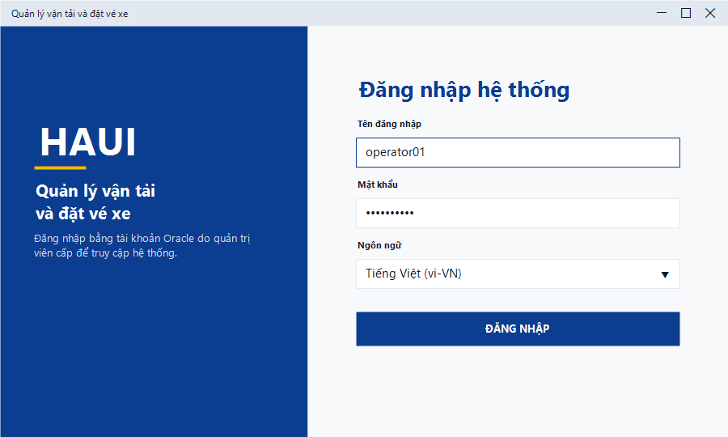

Người dùng đăng nhập bằng tài khoản Oracle cá nhân được cấp. Có thể chuyển đổi ngôn ngữ giao diện ngay tại màn hình đăng nhập.

### 4.3 Đăng ký tài khoản (Người dùng chưa có tài khoản)

Khi chưa có tài khoản, nhân viên tự đăng ký ngay tại màn hình đăng nhập:
1. Nhấn nút **Đăng ký tài khoản** ở cuối form đăng nhập.
2. Hộp thoại **Đăng ký tài khoản** xuất hiện:
   - **Tên đăng nhập**: Tối thiểu 3 ký tự, bắt đầu bằng chữ cái, chỉ chứa chữ cái, chữ số và dấu gạch dưới (`_`).
   - **Mật khẩu** và **Nhập lại mật khẩu**: theo quy tắc mật khẩu an toàn ở mục 4.4; hai ô phải khớp thì nút **Đăng ký** mới bật.
   - **Họ và tên**: Họ tên đầy đủ (tối đa 100 ký tự).
   - **Số điện thoại**: 10 chữ số, bắt đầu bằng 0, không bắt buộc.
3. Nhấn **Đăng ký**. Tài khoản Oracle được tạo ngay qua tài khoản kỹ thuật `TRANSPORT_REGISTRAR`, với quyền **Nhân viên bán vé**.
4. Hộp thoại đóng, tên đăng nhập được điền sẵn; nhập mật khẩu vừa đặt để đăng nhập (không phải đổi mật khẩu lần đầu).

Lưu ý: tên đăng nhập đã tồn tại sẽ bị báo lỗi; mỗi giờ hệ thống chỉ nhận tối đa 5 tài khoản tự đăng ký. Người điều hành có thể nâng quyền hoặc khóa tài khoản ở trang **Nhân viên**.

### 4.4 Đặt mật khẩu mới lần đầu hoặc khi mật khẩu hết hạn

Để đảm bảo an toàn thông tin, hệ thống áp dụng chính sách mật khẩu Oracle (`profile_staff` và hàm kiểm tra `staff_password_verify`):
- **Bắt buộc đổi mật khẩu tạm**: Tài khoản do người điều hành tạo hoặc được đặt lại mật khẩu có trạng thái hết hạn ngay (`PASSWORD EXPIRE`). Trong lần đăng nhập đầu tiên bằng mật khẩu tạm, hộp thoại **Đặt mật khẩu mới** sẽ tự động bật lên. Tài khoản tự đăng ký không bị áp dụng vì mật khẩu do chính người dùng đặt.
- **Thời hạn mật khẩu**: Mật khẩu có hiệu lực tối đa 90 ngày. Khi hết hạn (lỗi `ORA-28001`), ứng dụng yêu cầu đặt mật khẩu mới ngay khi đăng nhập.
- **Quy tắc mật khẩu an toàn**:
  - Độ dài tối thiểu 8 ký tự.
  - Phải chứa ít nhất 1 chữ cái in hoa (`A-Z`), 1 chữ cái in thường (`a-z`), 1 chữ số (`0-9`) và 1 ký tự đặc biệt (ví dụ `#`, `$`, `@`, `!`).
  - Không được chứa tên đăng nhập (dưới bất kỳ dạng hoa/thường nào).
  - Không được trùng với 5 mật khẩu gần nhất đã sử dụng (`PASSWORD_REUSE_MAX 5`).
- **Khóa tài khoản tự động**: Nhập sai mật khẩu liên tiếp 5 lần tài khoản sẽ bị tạm khóa 15 phút (`FAILED_LOGIN_ATTEMPTS 5`, `PASSWORD_LOCK_TIME 15/1440`).

### 4.5 Tự đổi mật khẩu định kỳ

Nhân viên có thể chủ động đổi mật khẩu bất kỳ lúc nào khi đang làm việc:
1. Nhấn nút **Đổi mật khẩu** (biểu tượng chìa khóa) ở góc trên bên phải thanh tiêu đề cửa sổ chính.
2. Hộp thoại **Đổi mật khẩu** xuất hiện:
   - Nhập **Mật khẩu hiện tại**.
   - Nhập **Mật khẩu mới** (tuân thủ quy tắc mật khẩu an toàn).
   - Nhập lại vào ô **Nhập lại mật khẩu mới** để xác nhận trùng khớp.
3. Nhấn **Đồng ý**. Hệ thống sẽ cập nhật mật khẩu trực tiếp trên CSDL Oracle và hiển thị thông báo thành công màu xanh.

### 4.6 (Người điều hành) Xem nhật ký đăng nhập

Dành riêng cho tài khoản người điều hành (`ROLE_OPERATOR`):

#### Tra cứu nhật ký đăng nhập (Menu 'Nhật ký đăng nhập')
1. Vào menu **Nhật ký đăng nhập** (biểu tượng bảo mật ổ khóa).
2. Lọc theo tên tài khoản hoặc khoảng thời gian (*Từ ngày* – *Đến ngày*) $\rightarrow$ Nhấn **Tìm kiếm**.
3. Dữ liệu được trích xuất trực tiếp từ Oracle Unified Auditing qua view `V_LOGIN_AUDIT`, hiển thị: Thời gian, Tài khoản, Hành động (`LOGON`, hoặc `EXECUTE` khi quản trị tài khoản hay tự đăng ký), Kết quả (`Thành công` / `Thất bại`), Tên máy trạm gửi kết nối và Đối tượng truy cập.
4. Nhấn **Xuất Excel** (`Ctrl + E`) để lưu báo cáo kiểm toán đăng nhập ra file `.xlsx`.


---

## 5. Tài khoản demo và phân quyền

### 5.1 Danh sách tài khoản demo

| Tài khoản | Mật khẩu | Vai trò | Mô tả nhiệm vụ |
|---|---|---|---|
| `operator01` | `Operator#01` | **Điều hành** (`ROLE_OPERATOR`) | Toàn quyền quản trị danh mục, phân công tài xế/xe, hủy chuyến, quản lý nhân viên, sao lưu dữ liệu |
| `seller01` | `Seller#001` | **Nhân viên bán vé** (`ROLE_TICKET_SELLER`) | Tra cứu chuyến, chọn ghế theo sơ đồ, đặt vé, thu tiền, in vé, hủy vé & hoàn tiền |
| `seller02` | `Seller#002` | **Nhân viên bán vé** (`ROLE_TICKET_SELLER`) | Tài khoản phụ bán vé tại quầy giao dịch |

### 5.2 Bảng ma trận phân quyền trên giao diện

| Tính năng / Màn hình | Người điều hành | Nhân viên bán vé |
|---|:---:|:---:|
| **Tổng quan (Dashboard)** | Xem toàn bộ số liệu | Xem toàn bộ số liệu |
| **Bán vé (Sơ đồ ghế & Đặt chỗ)** | Xem & Đặt vé | Xem & Đặt vé |
| **Quản lý vé** | Xem, Thanh toán, Hủy, In vé, Xuất Excel | Xem, Thanh toán, Hủy, In vé, Xuất Excel |
| **Hành khách** | Thêm, Sửa, Xóa, Lịch sử vé, Xuất Excel | Thêm, Sửa, Lịch sử vé, Xuất Excel (Không xóa) |
| **Tuyến xe** | Thêm, Sửa, Xóa, Xuất Excel | Chỉ xem danh sách |
| **Lịch chạy** | Thêm, Sửa, Hủy chuyến, Đổi trạng thái | Chỉ xem danh sách |
| **Phương tiện** | Toàn quyền quản lý danh mục xe | *Ẩn khỏi menu giao diện* |
| **Tài xế** | Toàn quyền quản lý, cảnh báo bằng lái | *Ẩn khỏi menu giao diện* |
| **Thống kê báo cáo** | Xem doanh thu, biểu đồ, xuất Excel | Xem doanh thu, biểu đồ, xuất Excel |
| **Nhân viên (Oracle Users)** | Thêm user, đổi role, reset MK, khóa | *Ẩn khỏi menu giao diện* |
| **Nhật ký đăng nhập** | Tra cứu audit trail, Xuất Excel | *Ẩn khỏi menu giao diện* |
| **Sao lưu & Khôi phục CSDL** | Kích hoạt sao lưu, xem job đêm | *Ẩn khỏi menu giao diện* |

> **Cơ chế an toàn phía Oracle**: Phân quyền được enforce chặt chẽ tại tầng CSDL. Tài khoản nhân viên bán vé **không có quyền INSERT/UPDATE trực tiếp** lên bảng `TICKETS` hay `PAYMENTS`. Mọi thao tác bán vé, thanh toán và hoàn tiền đều bắt buộc phải thông qua `PKG_TICKET`.

---

## 6. Hướng dẫn từng màn hình

### Quy tắc thao tác chung trên các bảng dữ liệu

- **Tìm kiếm nhanh**: Gõ từ khóa vào ô tìm kiếm hoặc nhấn tổ hợp `Ctrl + F`, danh sách sẽ tự động lọc dữ liệu tức thì.
- **Thêm mới bản ghi**: Nhấn nút **Thêm mới** hoặc phím tắt `Ctrl + N`, nhập thông tin vào biểu mẫu bên phải rồi nhấn **Lưu** (`Ctrl + S`).
- **Sửa thông tin**: Chọn dòng trong bảng rồi nhấn nút **Sửa** (hoặc nhấp đúp trực tiếp vào dòng).
- **Xóa bản ghi**: Chọn dòng cần xóa, nhấn **Xóa** và xác nhận trên hộp thoại cảnh báo.
- **Làm mới dữ liệu**: Nhấn phím `F5`.
- **Xuất báo cáo Excel**: Nhấn nút **Xuất Excel** hoặc phím tắt `Ctrl + E`, chọn thư mục lưu trữ file `.xlsx`.
- **Bắt lỗi nhập liệu**: Khi ô nhập liệu vi phạm ràng buộc (để trống ô bắt buộc, sai định dạng điện thoại...), ô sẽ hiển thị viền đỏ; rê chuột vào ô để xem chi tiết lý do.

---

### 6.1 Tổng quan

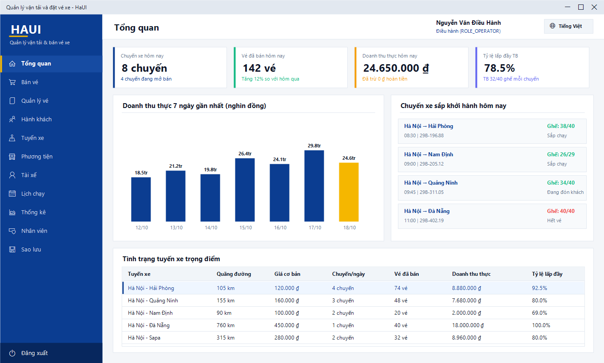

- **4 thẻ chỉ số nhanh (KPI hôm nay)**:
  - *Chuyến xe hôm nay*: Số chuyến trong ngày và số chuyến đang mở bán.
  - *Vé đã bán hôm nay*: Tổng số lượng vé đã xuất cho khách.
  - *Doanh thu thực hôm nay*: Tổng tiền thu thực tế (đã trừ tự động các khoản hoàn trả khi hủy vé).
  - *Tỷ lệ lấp đầy trung bình*: Tỷ lệ số ghế có khách trên tổng tải của tất cả các chuyến trong ngày.
- **Biểu đồ cột doanh thu thực 7 ngày**: Trực quan hóa biến động doanh thu theo từng ngày khởi hành. Cột ngày hôm nay được làm nổi bật màu vàng HaUI `#F5B700`.
- **Chuyến xe sắp khởi hành**: Danh sách các chuyến sắp chạy kèm biển số xe, giờ chạy và tình trạng số ghế trống.
- **Tình trạng tuyến xe trọng điểm**: Bảng thống kê các tuyến huyết mạch kèm cự ly, giá cơ bản, số vé đã bán và doanh thu lũy kế.

---

### 6.2 Bán vé

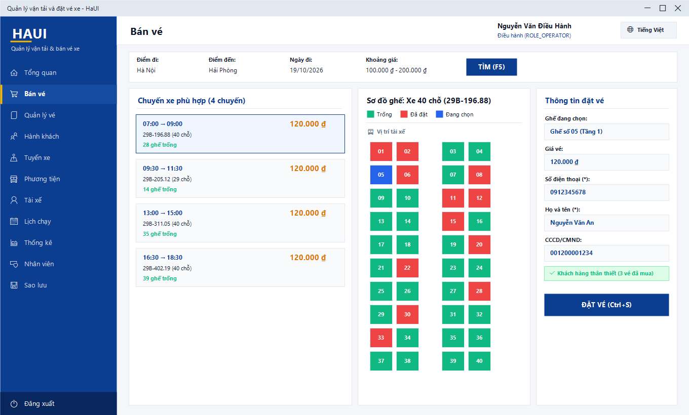

1. **Bộ lọc chuyến xe**: Chọn điểm đi, điểm đến, ngày khởi hành và khoảng giá vé (`Giá từ` - `Giá đến`) $\rightarrow$ Nhấn **Tìm** (`F5`).
2. **Danh sách chuyến**: Hiển thị các chuyến thỏa mãn điều kiện và còn mở bán. Khi chọn một chuyến, thông tin loại xe, cự ly và sơ đồ ghế tương ứng sẽ lập tức được hiển thị.
3. **Sơ đồ ghế trực quan**:
   - **Màu xanh lá**: Ghế còn trống, sẵn sàng đặt.
   - **Màu đỏ**: Ghế đã có khách đặt hoặc mua thành công.
   - **Màu xanh dương**: Ghế người dùng đang chọn để bán.
4. **Thông tin hành khách**: Nhập số điện thoại khách hàng $\rightarrow$ Nhấn **Tìm khách**.
   - Nếu là khách hàng cũ: Hệ thống tự động điền họ tên và CCCD, hiển thị huy hiệu *Khách hàng thân thiết*.
   - Nếu là khách hàng mới: Nhân viên nhập họ tên và CCCD (không bắt buộc) để tự động lưu vào danh bạ.
5. Nhấn **Đặt vé** (`Ctrl + S`) để chuyển sang bước thanh toán.

---

### 6.3 Quản lý vé

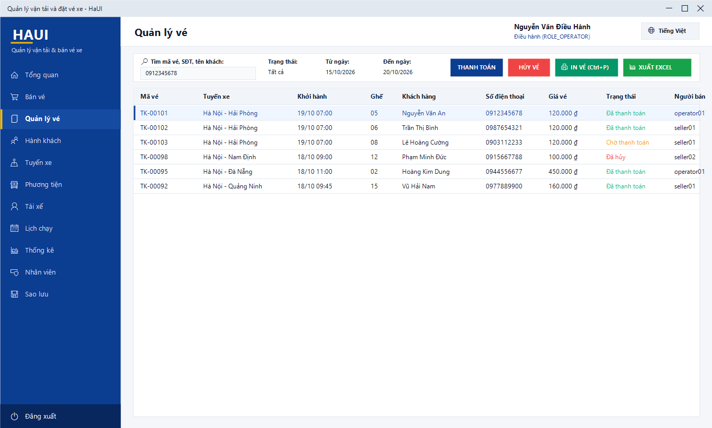

- Tra cứu vé linh hoạt theo mã vé, số điện thoại khách, tên khách hàng hoặc lọc theo trạng thái (`Đã thanh toán`, `Chờ thanh toán`, `Đã hủy`) và khoảng ngày khởi hành.
- **Thanh toán vé**: Thu tiền cho các vé đang ở trạng thái "Chờ thanh toán".
- **Hủy vé & Hoàn tiền**: Hủy vé theo yêu cầu của khách; hệ thống bắt buộc nhập lý do hủy và tự động sinh bản ghi hoàn trả tiền nếu vé trước đó đã được thanh toán.
- **In lại vé**: Nhấn nút **In vé** (`Ctrl + P`) để tái in vé xe ra máy in nhiệt hoặc xuất file PDF khổ A6.
- **Xuất Excel**: Nhấn `Ctrl + E` để trích xuất danh sách vé ra file `.xlsx` phục vụ đối soát ca bán hàng.

---

### 6.4 Hành khách

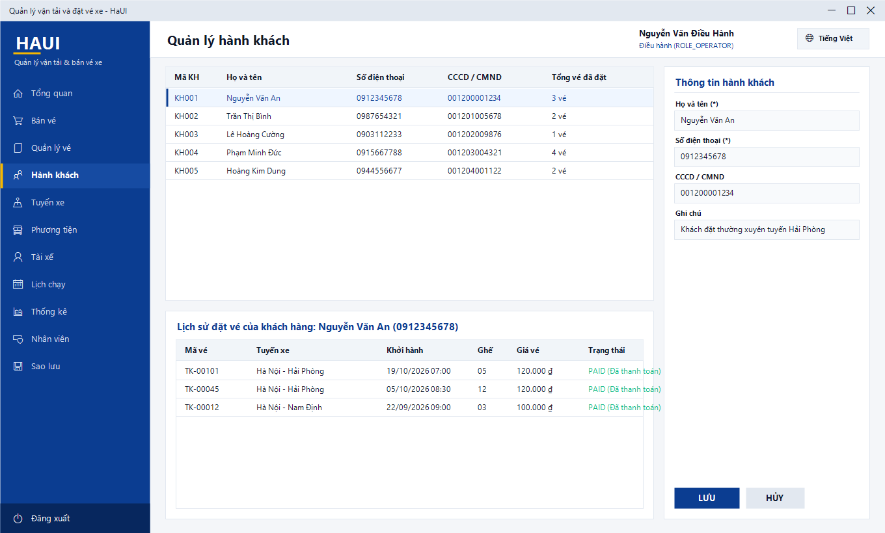

- Quản lý danh mục hành khách đi xe (Họ tên, SĐT, CCCD/CMND).
- Tìm kiếm nhanh hành khách theo tên hoặc số điện thoại.
- Khi nhấp chọn một hành khách ở bảng phía trên, khung bên dưới sẽ tự động hiển thị **Lịch sử đặt vé toàn bộ** của khách hàng đó từ trước đến nay (mã vé, tuyến đi, ngày giờ, số ghế, giá vé và trạng thái thanh toán).
- Nhân viên bán vé được phép Thêm và Cập nhật thông tin khách; chỉ Người điều hành mới có quyền Xóa bản ghi khách hàng (với điều kiện khách hàng đó chưa có vé nào trong hệ thống).

---

### 6.5 Tuyến xe

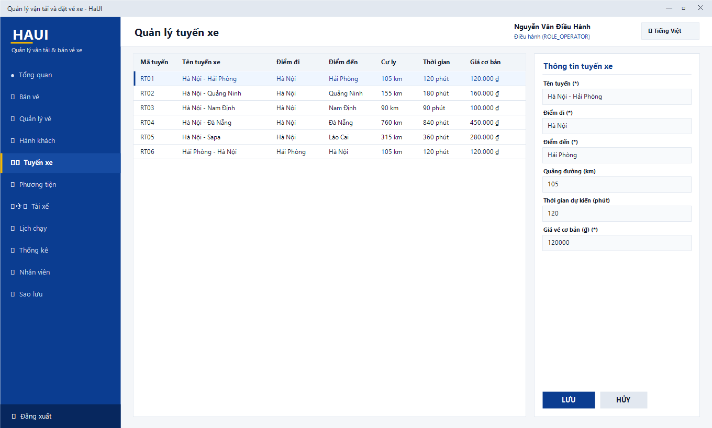

- Định nghĩa danh mục các tuyến vận tải liên tỉnh: Tên tuyến xe, Điểm đi, Điểm đến, Quãng đường (km), Thời gian chạy dự kiến (phút) và Giá vé cơ bản.
- Ràng buộc toàn vẹn: Điểm đi và Điểm đến bắt buộc phải khác nhau; giá vé cơ bản và cự ly phải lớn hơn 0.
- Các thông số giá vé và thời gian dự kiến sẽ được hệ thống tái sử dụng để **tự động điền mặc định** khi nhân viên tạo lịch chạy mới, giúp hạn chế tối đa sai sót thủ công.

---

### 6.6 Phương tiện (điều hành)

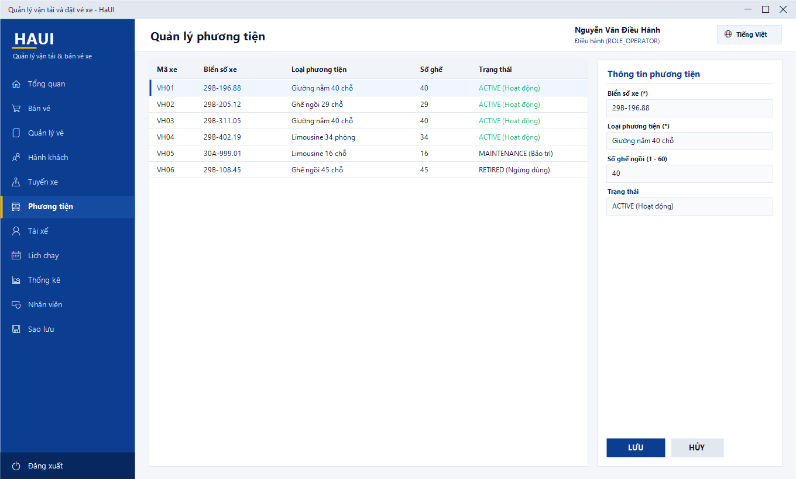

- Quản lý đội xe: Biển số xe (chuẩn định dạng biển số, ví dụ `29B-196.88`), loại xe (Giường nằm 40 chỗ, Limousine 34 phòng, Ghế ngồi 29 chỗ...), số lượng ghế (từ 1 đến 60 ghế) và trạng thái hoạt động.
- Trạng thái phương tiện gồm 3 mức:
  - `ACTIVE` (Đang hoạt động): Sẵn sàng để xếp lịch chạy.
  - `MAINTENANCE` (Đang bảo trì/bảo dưỡng định kỳ): Tạm khóa, không thể phân công vào chuyến mới.
  - `RETIRED` (Ngừng sử dụng/thanh lý): Không còn khai thác.

---

### 6.7 Tài xế (điều hành)

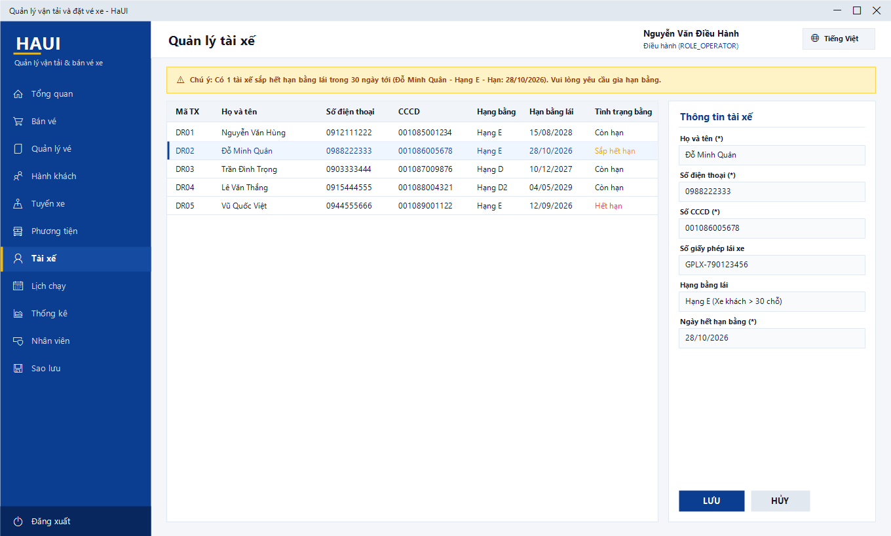

- Danh mục đội ngũ lái xe: Họ tên, Số điện thoại, CCCD, Số GPLX, Hạng bằng lái (D1, D2, D, E) và Ngày hết hạn bằng lái.
- **Cơ chế giám sát an toàn bằng lái**:
  - Dòng hiển thị **màu vàng**: Bằng lái còn hạn dưới 30 ngày $\rightarrow$ Cần nhắc nhở lái xe đi gia hạn.
  - Dòng hiển thị **màu đỏ**: Bằng lái đã chính thức hết hạn.
  - Phía trên cùng có **Dải cảnh báo màu vàng** tổng hợp nhanh số lượng tài xế sắp/đã hết hạn bằng.
  - Hệ thống tự động loại trừ tài xế đã hết hạn bằng khỏi danh sách lựa chọn khi điều hành viên phân công chuyến xe.

---

### 6.8 Lịch chạy

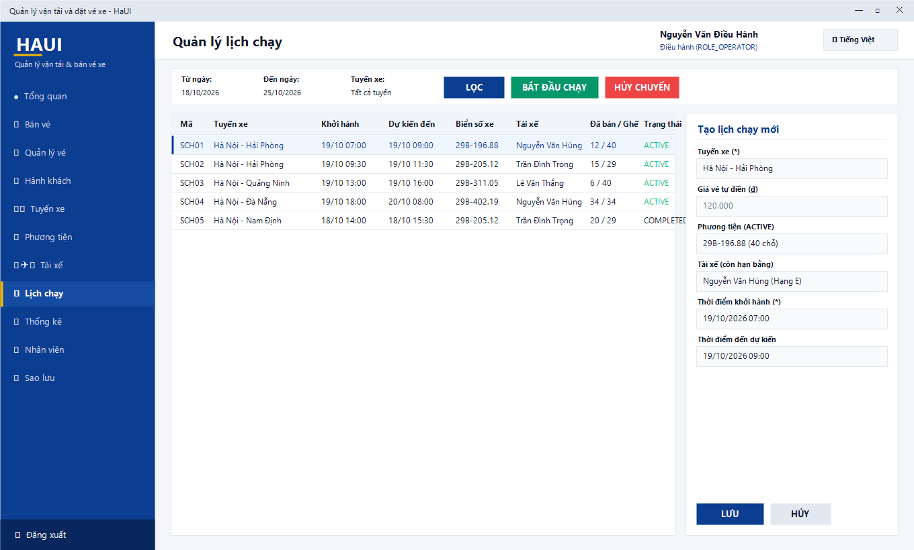

- Lập và điều hành các chuyến xe khởi hành hàng ngày.
- Bộ lọc khoảng ngày khởi hành giúp dễ dàng kiểm soát kế hoạch vận tải trong tuần/tháng.
- Cột *Đã bán / Số ghế* phản ánh tức thời tình trạng lấp đầy của từng chuyến (ví dụ `38 / 40`).
- **Thêm chuyến xe mới**:
  - Chọn tuyến xe $\rightarrow$ Hệ thống tự điền giá vé cơ bản và tự động cộng thời gian hành trình để gợi ý *Thời điểm đến dự kiến*.
  - Combobox xe chỉ liệt kê các phương tiện có trạng thái `ACTIVE`.
  - Combobox tài xế chỉ hiển thị những tài xế còn hạn giấy phép lái xe tính đến thời điểm chuyến khởi hành.
- **Điều hành trạng thái chuyến**:
  - Nút **Bắt đầu chạy**: Đổi trạng thái từ `Chờ chạy` sang `Đang chạy (RUNNING)`.
  - Nút **Hoàn thành**: Đổi sang `Đã hoàn thành (COMPLETED)` khi xe về bến an toàn.
  - Nút **Hủy chuyến**: Kích hoạt thủ tục hủy chuyến tập trung `PKG_SCHEDULE.CANCEL_SCHEDULE`, tự động hủy toàn bộ vé trên xe và ghi nhận hoàn tiền cho những hành khách đã thanh toán.

---

### 6.9 Thống kê

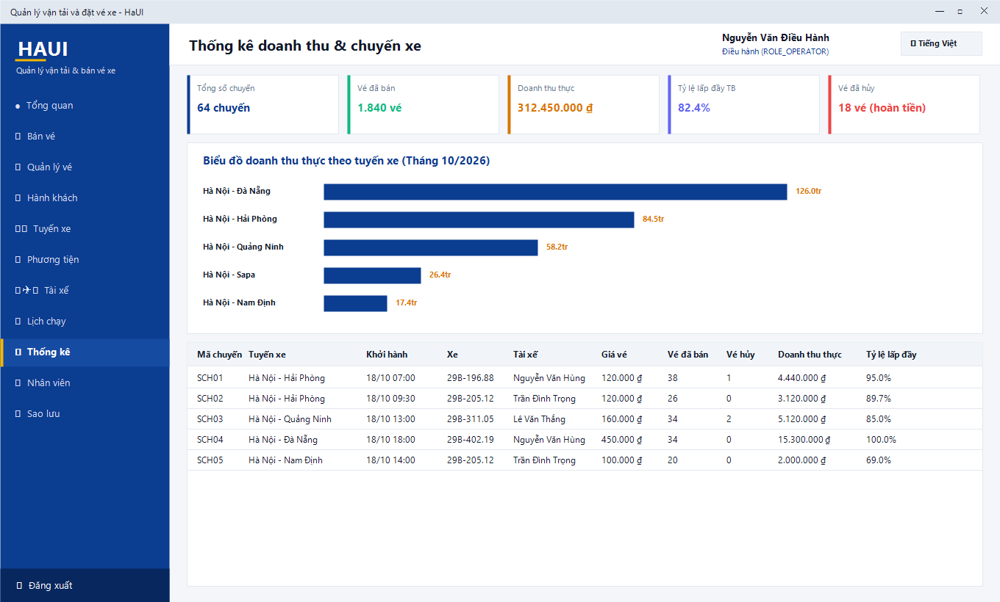

- Dữ liệu thống kê được truy vấn trực tiếp từ Database View `V_TRIP_STATISTICS`.
- Cho phép tra cứu linh hoạt theo khoảng thời gian tùy chọn và lọc riêng theo từng tuyến xe.
- **5 khối số liệu tổng hợp (KPI)**: Tổng số chuyến thực hiện, Tổng số vé đã bán, Doanh thu thực (đã trừ tiền hoàn vé), Tỷ lệ lấp đầy trung bình toàn mạng lưới, Tổng số lượng vé đã hủy.
- **Biểu đồ cột doanh thu theo tuyến xe**: Trực quan hóa tuyến đường nào mang lại doanh thu cao nhất (ví dụ tuyến đường dài Hà Nội - Đà Nẵng).
- **Bảng kê chi tiết từng chuyến xe**: Hiển thị rõ mã chuyến, biển số, tài xế, giá vé, số vé bán, số vé hủy, doanh thu thực và tỷ lệ lấp đầy. Hỗ trợ nút **Xuất Excel** để lập báo cáo ban giám đốc.

---

### 6.10 Đổi ngôn ngữ

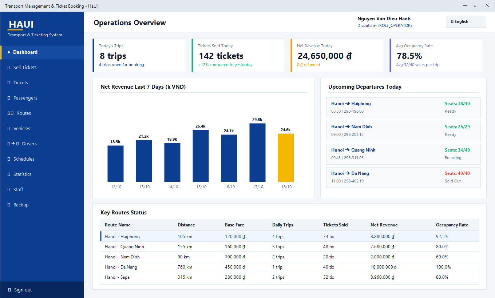

- Ứng dụng hỗ trợ song ngữ hoàn chỉnh: **Tiếng Việt (vi-VN)** và **Tiếng Anh (en-US)**.
- Người dùng có thể nhấn nút chuyển đổi ngôn ngữ ở góc trên bên phải thanh tiêu đề bất kỳ lúc nào; toàn bộ nhãn menu, tiêu đề cột, biểu mẫu và thông báo lỗi sẽ lập tức chuyển đổi mượt mà mà không cần khởi động lại ứng dụng.
- Lưu ý: Các định dạng tiền tệ (`120.000 ₫`) và ngày tháng (`19/10/2026`) luôn tuân thủ chuẩn kế toán Việt Nam trên cả hai chế độ ngôn ngữ.

---

### 6.11 File Excel xuất ra

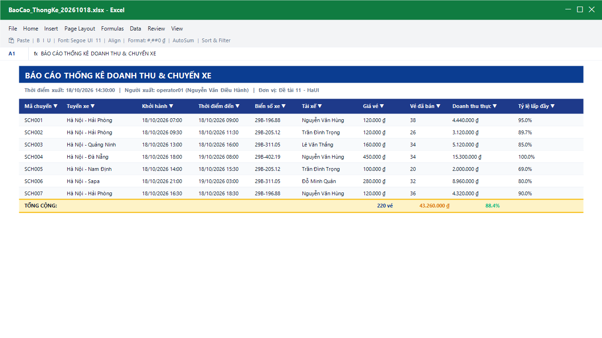

- Được kết xuất bằng thư viện chuyên dụng **ClosedXML** theo chuẩn bảng tính Microsoft Excel (`.xlsx`).
- **Bố cục báo cáo chuyên nghiệp**:
  - Dòng 1: Tiêu đề báo cáo in hoa, chữ đậm nổi bật trên nền xanh HaUI `#0B3D91`.
  - Dòng 2: Thời điểm xuất báo cáo và định danh người xuất (`operator01 - Nguyễn Văn Điều Hành`).
  - Dòng 4 trở đi: Bảng dữ liệu tự động kích hoạt tính năng **AutoFilter** (mũi tên lọc dữ liệu ở từng cột).
  - Cột số tiền được định dạng kế toán `#,##0 ₫`, cột ngày giờ hiển thị rõ ràng `dd/MM/yyyy HH:mm`.
  - Dòng cuối cùng: Hàng tổng cộng số lượng và tổng doanh thu có màu nền nhấn màu vàng.

---

## 7. Quy trình bán vé đầy đủ

Quy trình chuẩn dành cho nhân viên bán vé tại quầy:

```
[1. Chọn chuyến xe] ➔ [2. Chọn số ghế] ➔ [3. Nhập SĐT khách] ➔ [4. Đặt vé] ➔ [5. Thu tiền] ➔ [6. In vé]
```

1. **Tìm chuyến xe**:
   - Truy cập menu **Bán vé**.
   - Chọn điểm đi, điểm đến và ngày khởi hành $\rightarrow$ Nhấn **Tìm (F5)**.
2. **Chọn chuyến và vị trí ghế ngồi**:
   - Nhấp chọn chuyến xe còn ghế trống phù hợp với khung giờ của khách.
   - Trên sơ đồ ghế, nhấp chuột vào một ghế màu **xanh lá** (ghế trống) $\rightarrow$ Ghế được chọn sẽ chuyển sang màu **xanh dương**.
3. **Nhập thông tin khách hàng**:
   - Nhập số điện thoại của hành khách vào ô `Số điện thoại` $\rightarrow$ Nhấn nút **Tìm khách**.
   - Nếu là khách quen: Hệ thống tự động điền họ tên.
   - Nếu là khách mới: Nhập bổ sung họ tên của khách hàng.
4. **Xác nhận đặt vé**:
   - Nhấn nút **Đặt vé** (`Ctrl + S`).
   - Hệ thống gọi procedure `PKG_TICKET.BOOK_TICKET`. Ngay lập tức, trigger `TRG_TICKETS_CHECK_SEAT` trên CSDL Oracle sẽ thẩm định ghế. Trong trường hợp có quầy vé khác vừa kịp đặt ghế này trước đó một phần nghìn giây, Oracle sẽ chặn đứng tranh chấp và hiển thị thông báo: *"Ghế {X} đã có người đặt, vui lòng chọn ghế khác"*.
5. **Thanh toán tiền vé**:
   - Hộp thoại **Thanh toán vé xe** hiển thị số tiền cần thu.
   - Chọn hình thức khách trả: **Tiền mặt (CASH)**, **Chuyển khoản (TRANSFER)** hoặc **Quẹt thẻ (CARD)**.
   - Nhấn **Đồng ý thanh toán** để hoàn tất thu tiền (vé chuyển sang trạng thái `PAID`).
   - *Lưu ý*: Nếu khách chưa muốn thanh toán ngay, nhân viên có thể nhấn **Hủy bỏ (để thanh toán sau)**, vé sẽ được giữ ở trạng thái `BOOKED` (Chờ thanh toán).

   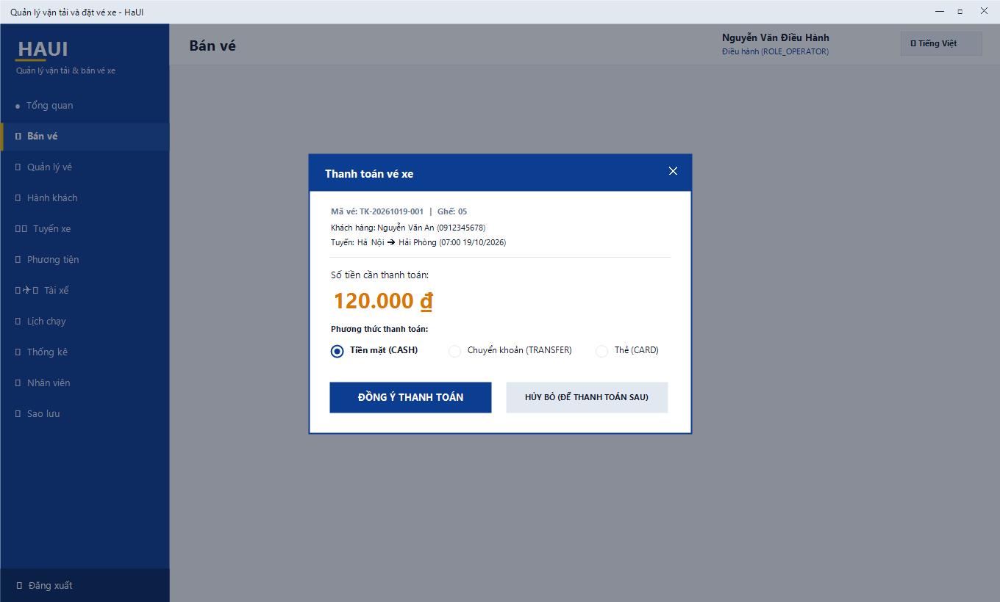

6. **In vé giao cho khách**:
   - Sau khi thanh toán thành công, hệ thống hiển thị thông báo hỏi bạn có muốn in vé không.
   - Chọn **Có** $\rightarrow$ Hộp thoại chọn máy in mở ra. Chọn máy in nhiệt tại quầy hoặc chọn *"Microsoft Print to PDF"* để xuất file PDF khổ chuẩn A6.
7. **Hủy vé và hoàn tiền (khi khách đổi ý)**:
   - Vào màn hình **Quản lý vé** $\rightarrow$ Tìm và chọn vé của khách $\rightarrow$ Nhấn **Hủy vé**.
   - Bắt buộc nhập lý do hủy vé vào hộp thoại.
   - Đối với vé đã thanh toán: CSDL tự động sinh một bản ghi hoàn tiền (REFUND) với số tiền hoàn 100% giá vé và giải phóng ghế ngay lập tức để người khác có thể đặt lại.
   - *Quy tắc an toàn*: Hệ thống tuyệt đối không cho phép hủy vé đối với các chuyến xe đã đến hoặc quá giờ khởi hành.

---

## 8. Quản lý nhân viên

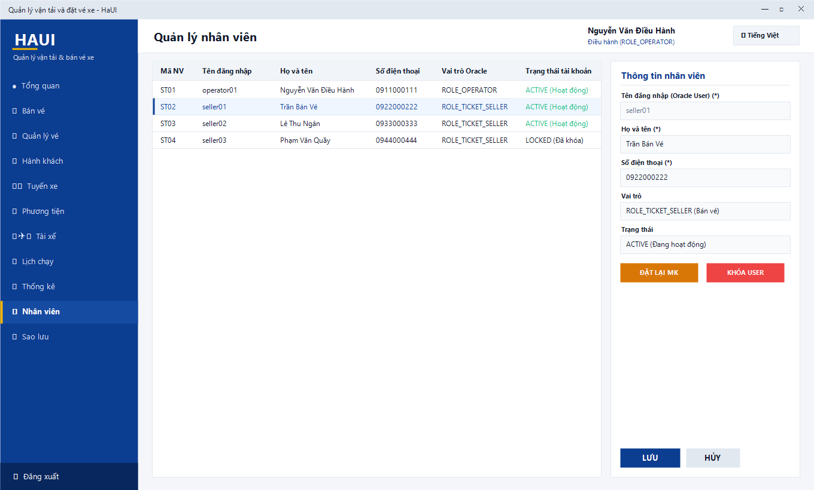

Tính năng quản lý nhân viên chỉ hiển thị đối với tài khoản có vai trò **Người điều hành (`ROLE_OPERATOR`)**.

Trong hệ thống này, mỗi nhân viên là một **Database User độc lập trên Oracle Database 21c XE**, được tạo và phân quyền thông qua package an toàn `PKG_STAFF`.

- **Thêm nhân viên mới**:
  - Nhấn **Thêm mới** (`Ctrl + N`).
  - *Tên đăng nhập*: Từ 3 đến 30 ký tự, bắt đầu bằng chữ cái, chỉ chứa chữ số và dấu gạch dưới (hệ thống tự động kiểm tra chống SQL Injection).
  - *Mật khẩu ban đầu*: Tối thiểu 8 ký tự, tuân thủ chính sách mật khẩu Oracle.
  - *Họ tên, Số điện thoại*: Nhập thông tin liên hệ của nhân viên.
  - *Vai trò*: Chọn `ROLE_OPERATOR` (Người điều hành) hoặc `ROLE_TICKET_SELLER` (Nhân viên bán vé).
  - Nhấn **Lưu** $\rightarrow$ Oracle sẽ tự động thực thi `CREATE USER` và gán `GRANT <ROLE>`.
- **Cập nhật thông tin**: Chọn nhân viên, sửa họ tên hoặc số điện thoại, rồi nhấn **Lưu**. (Tên đăng nhập là định danh Oracle cố định, không thể thay đổi).
- **Đổi vai trò nhân viên**: Chọn nhân viên $\rightarrow$ Đổi vai trò sang Người điều hành hoặc Bán vé $\rightarrow$ Nhấn **Lưu**. Oracle sẽ tự động `REVOKE` role cũ và `GRANT` role mới.
- **Đặt lại mật khẩu (Reset Password)**: Chọn nhân viên $\rightarrow$ Nhấn **Đặt lại MK** $\rightarrow$ Nhập mật khẩu mới an toàn $\rightarrow$ Xác nhận.
- **Khóa / Mở khóa tài khoản**:
  - Khi nhân viên nghỉ việc hoặc tạm dừng công tác, người điều hành nhấn nút **Khóa User** $\rightarrow$ CSDL Oracle thực thi lệnh `ALTER USER ... ACCOUNT LOCK`. Tài khoản này sẽ bị từ chối đăng nhập ngay lập tức.
  - Khi cần sử dụng lại, nhấn **Mở khóa** (`ACCOUNT UNLOCK`).
  - *Bảo vệ toàn vẹn*: Hệ thống không cho phép xóa vĩnh viễn nhân viên (để bảo lưu lịch sử giao dịch bán vé). Người điều hành cũng không thể tự khóa tài khoản hoặc tự hạ quyền của chính mình.

---

## 9. Sao lưu và khôi phục

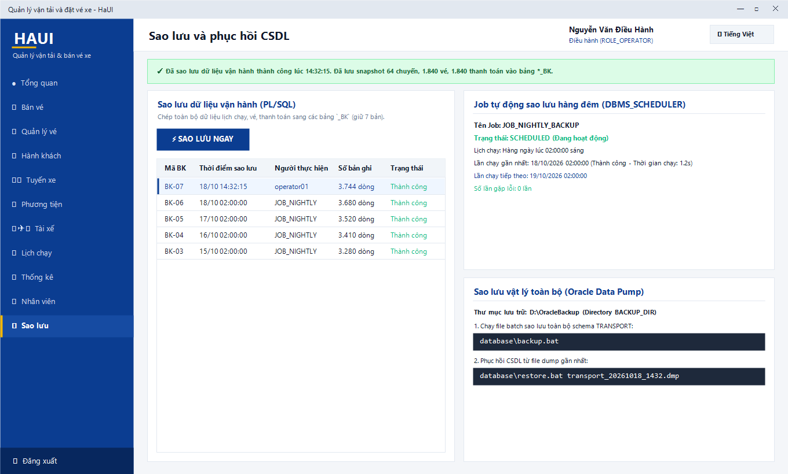

Hệ thống kết hợp mô hình sao lưu 2 lớp bổ trợ lẫn nhau, đảm bảo dữ liệu luôn được an toàn tuyệt đối:

### 9.1 Sao lưu dữ liệu vận hành (Snapshot bên trong CSDL)

- **Sao lưu chủ động tức thì**:
  - Tại màn hình **Sao lưu**, người điều hành nhấn nút **⚡ SAO LƯU NGAY**.
  - Hệ thống gọi thủ tục nội bộ `BACKUP_OPERATIONAL_DATA`: Tự động chép toàn bộ dữ liệu lịch chạy, vé xe và thanh toán sang các bảng lưu trữ nghiệp vụ `SCHEDULES_BK`, `TICKETS_BK`, `PAYMENTS_BK`.
  - Hệ thống tự động duy trì tối đa 7 bản sao lưu gần nhất (tự xoay vòng dọn dẹp các bản cũ hơn) và ghi nhật ký minh bạch vào bảng `BACKUP_LOGS`.
- **Sao lưu tự động hàng đêm (Nightly Job)**:
  - Job Oracle Scheduler `JOB_NIGHTLY_BACKUP` được kích hoạt tự động vào lúc **02:00:00 sáng hàng ngày**.
  - Thẻ thông tin trên màn hình hiển thị chi tiết: Tên Job, Trạng thái (SCHEDULED), Thời điểm chạy gần nhất, Thời điểm chạy tiếp theo và Số lần gặp lỗi (0 lần).

### 9.2 Sao lưu và khôi phục toàn diện bằng Oracle Data Pump (File .dmp)

Dành cho quản trị viên hệ thống để sao lưu vật lý toàn bộ schema, bảng, trigger và package ra ổ đĩa:

#### a) Sao lưu vật lý (Backup ra file .dmp):
Mở Command Prompt và chạy file batch:
```cmd
database\backup.bat
```
Script sẽ sử dụng tiện ích `expdp` của Oracle để kết xuất toàn bộ dữ liệu vào thư mục `D:\OracleBackup` dưới định dạng:
`D:\OracleBackup\transport_YYYYMMDD_HHMM.dmp` kèm theo file nhật ký `transport_YYYYMMDD_HHMM.log`.

#### b) Phục hồi CSDL (Restore từ file .dmp):
Khi cần khôi phục lại dữ liệu từ một bản sao lưu cụ thể:
```cmd
database\restore.bat transport_20261018_1432.dmp
```
Script sẽ gọi tiện ích `impdp` để phục hồi lại toàn bộ cấu trúc và dữ liệu.  
*Lưu ý*: Các thông báo dạng `"ORA-31684: Object type ... already exists"` đối với các package/view/job khi phục hồi là hoàn toàn bình thường do các đối tượng nền tảng đã tồn tại sẵn trong CSDL.

---

## 10. Xử lý lỗi thường gặp

Bảng tra cứu nguyên nhân và giải pháp khắc phục các tình huống phát sinh:

| Thông báo lỗi hiển thị | Nguyên nhân gốc rễ | Hướng dẫn khắc phục |
|---|---|---|
| **Không thể kết nối đến máy chủ Oracle...** | Dịch vụ `OracleServiceXE` hoặc `OracleOraDB21Home1TNSListener` chưa chạy, hoặc sai địa chỉ `DataSource` trong file cấu hình | Mở `services.msc`, kiểm tra và Start lại 2 dịch vụ Oracle. Kiểm tra lại chuỗi `DataSource: "localhost:1521/XEPDB1"` trong file `appsettings.json`. |
| **Đăng nhập báo sai tên/mật khẩu hoặc bị khóa** | Nhập sai tài khoản hoặc mật khẩu (ORA-01017) hoặc tài khoản bị khóa do sai quá 5 lần / quản trị viên khóa (ORA-28000) | Kiểm tra kỹ phím CapsLock; nếu đã nhập sai 5 lần, chờ 15 phút hoặc nhờ người điều hành mở khóa / cấp lại mật khẩu tạm. |
| **Mật khẩu đã hết hạn. Vui lòng đặt mật khẩu mới** | Mật khẩu tài khoản đã quá hạn 90 ngày hoặc là mật khẩu tạm do điều hành cấp (ORA-28001) | Nhập mật khẩu mới thỏa mãn chính sách bảo mật (≥ 8 ký tự, có hoa, thường, số, ký tự đặc biệt) trên hộp thoại xuất hiện. |
| **Không được dùng lại mật khẩu gần đây** | Mật khẩu mới trùng với 1 trong 5 mật khẩu đã dùng trước đó (ORA-28007) | Chọn mật khẩu mới khác hoàn toàn so với các mật khẩu gần đây. |
| **Bạn không có quyền thực hiện thao tác này** | Tài khoản nhân viên bán vé cố gắng thực hiện các thao tác chỉ dành cho điều hành (ORA-01031) | Thao tác đã bị hệ thống chặn theo đúng phân quyền nghiệp vụ. Chỉ tài khoản Điều hành mới thực hiện được. |
| **Ghế {0} đã có người đặt** | Một quầy vé khác vừa hoàn tất đặt chiếc ghế này trước bạn vài giây (lỗi ORA-20003) | Hệ thống đã tự động làm mới sơ đồ ghế. Vui lòng hướng dẫn khách hàng lựa chọn một số ghế màu xanh khác. |
| **Chuyến xe đã khởi hành, không thể đặt hoặc hủy vé** | Thời điểm hiện tại đã quá giờ xe lăn bánh (ORA-20004 / ORA-20032) | Giải thích cho khách hàng về quy định xuất bến; chọn chuyến xe ở khung giờ tiếp theo. |
| **Chuyến xe hiện còn vé hiệu lực, hãy dùng chức năng 'Hủy chuyến'** | Cố gắng đổi trực tiếp trạng thái chuyến sang `CANCELLED` mà chưa giải quyết quyền lợi cho hành khách (ORA-20052) | Sử dụng nút **HỦY CHUYẾN** trên thanh công cụ Lịch chạy để hệ thống tự động hoàn tiền cho toàn bộ hành khách trên xe. |
| **Không thể xóa vì đang có dữ liệu ràng buộc liên quan** | Xóa tuyến xe, phương tiện, tài xế hoặc khách hàng đã phát sinh lịch sử chuyến/vé (ORA-02292) | Không nên xóa các danh mục này. Hãy chuyển trạng thái của phương tiện/tài xế sang *Bảo trì/Ngừng dùng* để bảo toàn dữ liệu lịch sử. |
| **Dữ liệu bị trùng lặp trong hệ thống** | Vi phạm ràng buộc duy nhất (Unique Constraint: trùng Biển số xe, SĐT, CCCD, GPLX, Tên tuyến...) | Kiểm tra lại thông tin vừa nhập, tránh nhập trùng với các đối tượng đã có trong danh mục. |
| **Dữ liệu không hợp lệ** | Vi phạm ràng buộc nghiệp vụ (ví dụ Điểm đi trùng Điểm đến, số ghế nhỏ hơn 1 hoặc lớn hơn 60...) | Đọc kỹ thông báo hướng dẫn màu đỏ và điều chỉnh dữ liệu đầu vào cho đúng quy tắc. |
| **Chữ tiếng Việt bị hiển thị dấu hỏi (?) trong CSDL** | Chạy script SQL thủ công trong môi trường chưa thiết lập biến môi trường ký tự `NLS_LANG` | Luôn sử dụng file `database\install_all.bat` để cài đặt vì script đã được cấu hình sẵn biến `NLS_LANG=AMERICAN_AMERICA.AL32UTF8`. |

---

*Hết tài liệu Hướng dẫn sử dụng.*
